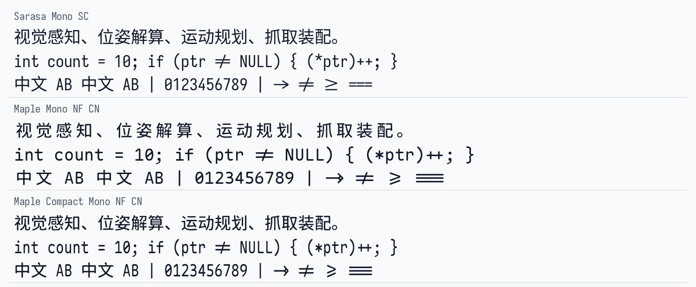

# Maple Compact Mono

**让 Maple Mono 的英文更紧凑，让中文回到自然的字间距。**

Maple Mono 的圆角和连字很适合编程，但 CN 版本为了保持中英文 2∶1 对齐，将英文字符设置为 600 单位、中文占位设置为 1200 单位，中文左右的留白因此比较明显。

Maple Compact Mono 将英文横向收窄到原来的 **5/6**，占宽由 **600 改为 500**；中文占位由 **1200 改为 1000**，中文字形本身不缩小。这样既保留了中英文 2∶1 对齐，也减少了中文两侧留白。

## 效果预览

同一字号下，从上到下分别是等距更纱、Maple Mono 原版、Maple Compact Mono：



斜体对比，上方为原版，下方为 Compact：


| | Maple Mono | Maple Compact Mono |
| :--- | :--- | :--- |
| 英文占宽 | 600 | 500 |
| 中文占宽（CN） | 1200 | 1000 |
| 中文字形大小 | 原大小 | 保持原大小 |
| 中英文对齐 | 2∶1 | 2∶1 |
| 连字、字符变体与 NF 图标 | 上游提供 | 保留上游规则，英文和图标随字宽收窄 |
| 可变字体 | 字重轴 | 保留字重轴 |

## 下载

**中文编程和终端使用，建议先下载 [MapleCompactMono-NF-CN-unhinted.zip](https://github.com/XingYu4m18/maple_compact_mono/releases/latest/download/MapleCompactMono-NF-CN-unhinted.zip)。**

完整下载与版本记录：[Releases](https://github.com/XingYu4m18/maple_compact_mono/releases)。当前完整构建基于 Maple Mono **v7.9**，下载包与上游一一对应，只在 `Maple` 后加入 `Compact`。每个静态包包含全部 **8 个字重及其斜体，共 16 个字体文件**；可变字体包包含正体、斜体两个带字重轴的字体文件。

| 格式 / 分类 | 默认连字 | NL 无连字 | Normal 连字 | NormalNL 无连字 |
| :--- | :---: | :---: | :---: | :---: |
| Variable | [下载](https://github.com/XingYu4m18/maple_compact_mono/releases/latest/download/MapleCompactMono-Variable.zip) | [下载](https://github.com/XingYu4m18/maple_compact_mono/releases/latest/download/MapleCompactMonoNL-Variable.zip) | [下载](https://github.com/XingYu4m18/maple_compact_mono/releases/latest/download/MapleCompactMonoNormal-Variable.zip) | [下载](https://github.com/XingYu4m18/maple_compact_mono/releases/latest/download/MapleCompactMonoNormalNL-Variable.zip) |
| TTF | [下载](https://github.com/XingYu4m18/maple_compact_mono/releases/latest/download/MapleCompactMono-TTF.zip) | [下载](https://github.com/XingYu4m18/maple_compact_mono/releases/latest/download/MapleCompactMonoNL-TTF.zip) | [下载](https://github.com/XingYu4m18/maple_compact_mono/releases/latest/download/MapleCompactMonoNormal-TTF.zip) | [下载](https://github.com/XingYu4m18/maple_compact_mono/releases/latest/download/MapleCompactMonoNormalNL-TTF.zip) |
| TTF AutoHint | [下载](https://github.com/XingYu4m18/maple_compact_mono/releases/latest/download/MapleCompactMono-TTF-AutoHint.zip) | [下载](https://github.com/XingYu4m18/maple_compact_mono/releases/latest/download/MapleCompactMonoNL-TTF-AutoHint.zip) | [下载](https://github.com/XingYu4m18/maple_compact_mono/releases/latest/download/MapleCompactMonoNormal-TTF-AutoHint.zip) | [下载](https://github.com/XingYu4m18/maple_compact_mono/releases/latest/download/MapleCompactMonoNormalNL-TTF-AutoHint.zip) |
| OTF | [下载](https://github.com/XingYu4m18/maple_compact_mono/releases/latest/download/MapleCompactMono-OTF.zip) | [下载](https://github.com/XingYu4m18/maple_compact_mono/releases/latest/download/MapleCompactMonoNL-OTF.zip) | [下载](https://github.com/XingYu4m18/maple_compact_mono/releases/latest/download/MapleCompactMonoNormal-OTF.zip) | [下载](https://github.com/XingYu4m18/maple_compact_mono/releases/latest/download/MapleCompactMonoNormalNL-OTF.zip) |
| WOFF2 | [下载](https://github.com/XingYu4m18/maple_compact_mono/releases/latest/download/MapleCompactMono-Woff2.zip) | [下载](https://github.com/XingYu4m18/maple_compact_mono/releases/latest/download/MapleCompactMonoNL-Woff2.zip) | [下载](https://github.com/XingYu4m18/maple_compact_mono/releases/latest/download/MapleCompactMonoNormal-Woff2.zip) | [下载](https://github.com/XingYu4m18/maple_compact_mono/releases/latest/download/MapleCompactMonoNormalNL-Woff2.zip) |
| NF | [下载](https://github.com/XingYu4m18/maple_compact_mono/releases/latest/download/MapleCompactMono-NF-unhinted.zip) | [下载](https://github.com/XingYu4m18/maple_compact_mono/releases/latest/download/MapleCompactMonoNL-NF-unhinted.zip) | [下载](https://github.com/XingYu4m18/maple_compact_mono/releases/latest/download/MapleCompactMonoNormal-NF-unhinted.zip) | [下载](https://github.com/XingYu4m18/maple_compact_mono/releases/latest/download/MapleCompactMonoNormalNL-NF-unhinted.zip) |
| NF hinted | [下载](https://github.com/XingYu4m18/maple_compact_mono/releases/latest/download/MapleCompactMono-NF.zip) | [下载](https://github.com/XingYu4m18/maple_compact_mono/releases/latest/download/MapleCompactMonoNL-NF.zip) | [下载](https://github.com/XingYu4m18/maple_compact_mono/releases/latest/download/MapleCompactMonoNormal-NF.zip) | [下载](https://github.com/XingYu4m18/maple_compact_mono/releases/latest/download/MapleCompactMonoNormalNL-NF.zip) |
| CN | [下载](https://github.com/XingYu4m18/maple_compact_mono/releases/latest/download/MapleCompactMono-CN-unhinted.zip) | [下载](https://github.com/XingYu4m18/maple_compact_mono/releases/latest/download/MapleCompactMonoNL-CN-unhinted.zip) | [下载](https://github.com/XingYu4m18/maple_compact_mono/releases/latest/download/MapleCompactMonoNormal-CN-unhinted.zip) | [下载](https://github.com/XingYu4m18/maple_compact_mono/releases/latest/download/MapleCompactMonoNormalNL-CN-unhinted.zip) |
| CN hinted | [下载](https://github.com/XingYu4m18/maple_compact_mono/releases/latest/download/MapleCompactMono-CN.zip) | [下载](https://github.com/XingYu4m18/maple_compact_mono/releases/latest/download/MapleCompactMonoNL-CN.zip) | [下载](https://github.com/XingYu4m18/maple_compact_mono/releases/latest/download/MapleCompactMonoNormal-CN.zip) | [下载](https://github.com/XingYu4m18/maple_compact_mono/releases/latest/download/MapleCompactMonoNormalNL-CN.zip) |
| NF-CN | [下载](https://github.com/XingYu4m18/maple_compact_mono/releases/latest/download/MapleCompactMono-NF-CN-unhinted.zip) | [下载](https://github.com/XingYu4m18/maple_compact_mono/releases/latest/download/MapleCompactMonoNL-NF-CN-unhinted.zip) | [下载](https://github.com/XingYu4m18/maple_compact_mono/releases/latest/download/MapleCompactMonoNormal-NF-CN-unhinted.zip) | [下载](https://github.com/XingYu4m18/maple_compact_mono/releases/latest/download/MapleCompactMonoNormalNL-NF-CN-unhinted.zip) |
| NF-CN hinted | [下载](https://github.com/XingYu4m18/maple_compact_mono/releases/latest/download/MapleCompactMono-NF-CN.zip) | [下载](https://github.com/XingYu4m18/maple_compact_mono/releases/latest/download/MapleCompactMonoNL-NF-CN.zip) | [下载](https://github.com/XingYu4m18/maple_compact_mono/releases/latest/download/MapleCompactMonoNormal-NF-CN.zip) | [下载](https://github.com/XingYu4m18/maple_compact_mono/releases/latest/download/MapleCompactMonoNormalNL-NF-CN.zip) |

选包说明：

- **默认 / NL / Normal / NormalNL**：分别是默认连字、默认无连字、接近传统编程字体造型的连字与无连字版本。
- **NF**：包含 Nerd Fonts 图标；**CN**：包含中日文字形；**NF-CN**：同时包含图标与中文字形。
- **TTF / OTF**：适合桌面应用；**WOFF2**：适合网页；**Variable**：适合支持可变字体的应用。
- **hinted / AutoHint**：针对收窄后的 TrueType 字体重新生成 hinting；**unhinted**：不带该指令。不要将旧字宽下的 hinting 直接沿用到新字体。

同一造型的 hinted 与 unhinted 使用相同字体家族名，选择其中一种安装即可。字体内部名称保留上游的后缀，例如 `Maple Mono NF CN` 对应 `Maple Compact Mono NF CN`，`MapleMonoNormalNL-Bold.ttf` 对应 `MapleCompactMonoNormalNL-Bold.ttf`。

## 安装使用

### Windows

解压下载包，选中需要的 `.ttf` 或 `.otf` 文件，右键选择“安装”。重新启动使用字体的应用，在字体列表中选择相应的 **Maple Compact Mono** 家族。

### Ubuntu / Linux

将解压后的下载包文件夹复制到 `~/.local/share/fonts/`，然后执行：

```bash
fc-cache -f
fc-match 'Maple Compact Mono NF CN'
```

### macOS

在“字体册”中打开并安装解压后的字体文件，然后在应用中选择对应家族。

首次安装后，已经运行的应用可能需要完整退出并重新打开才能识别新字体。普通版和 NF 版没有中文字库，中文显示依赖应用的备用字体；需要统一中英文外观时选择 CN 或 NF-CN。

### 校验下载

每个 ZIP 都有同名 `.sha256` 文件，内容是该 ZIP 的 SHA-256。Linux 上可以查看并对比：

```bash
sha256sum MapleCompactMono-NF-CN-unhinted.zip
cat MapleCompactMono-NF-CN-unhinted.sha256
```

每包还附有 `compact-build.json`，记录来源版本、源压缩包校验值、字体数量、字体校验值和验证结果。

## 自行构建以后的新版

需要 **Python 3.10+**。建议使用 [uv](https://docs.astral.sh/uv/) 管理脚本依赖：

```bash
git clone https://github.com/XingYu4m18/maple_compact_mono.git
cd maple_compact_mono
uv run --with-requirements requirements.txt python tools/build_compact.py --all --upstream-version latest
```

脚本会查询上游最新稳定版，下载并校验各个发布包，处理其中所有字体，验证后按上游命名生成 ZIP 与 SHA-256。结果保存在 `dist/v版本号/`。完整构建涉及多个中文字库和数百个字体，需要一定的网络流量、磁盘空间和时间。

只构建自己需要的一包：

```bash
uv run --with-requirements requirements.txt python tools/build_compact.py \
  --upstream-version latest \
  --asset MapleMono-NF-CN-unhinted.zip
```

指定上游版本：

```bash
uv run --with-requirements requirements.txt python tools/build_compact.py --all --upstream-version 7.9
```

查看所选版本的全部下载包，不下载字体：

```bash
uv run --with-requirements requirements.txt python tools/build_compact.py --upstream-version latest --list
```

没有 uv 时，也可以创建 Python 虚拟环境，安装 `requirements.txt` 后直接运行同一脚本。仓库保存了 v7.9 的上游发布清单；指定更新版本时才查询新的清单，不会自动安装或替换本机字体。

### 在 GitHub Actions 构建并发布

在自己的仓库中打开 **Actions → Build and publish fonts → Run workflow**，填写上游版本号或 `latest`。也可以推送对应的版本标签，例如 `v7.9`。

工作流按包并行构建，全部验证通过且下载包、校验文件齐全后，才发布 Release。已有公开 Release 不会被自动覆盖。未来上游若增加格式、修改字宽或字体结构，脚本会提示需要适配；日常构建无需修改脚本中的版本号。

## 排版说明

- 英文、符号和图标的横向比例会改变，这是紧凑排版的取舍。
- 保持中文字形原大小并收紧占位后，部分中文斜体笔画会伸出字符格；某些应用可能出现紧贴或裁切。
- 小字号清晰度取决于字体版本、操作系统与渲染器，可分别试用 hinted 和 unhinted。
- 构建验证检查字符映射、OpenType 替换规则、几何变换及纵向度量；可变字体还检查多个字重位置。具体显示效果仍以使用的应用为准。

## 来源与协议

基于 [Maple Mono](https://github.com/subframe7536/maple-font) 构建，字体继续使用 **SIL Open Font License 1.1**。保留版权与许可证，允许按协议使用、修改和再分发，不可将字体本身单独出售。

完整协议见 [OFL.txt](OFL.txt)，中文与图标组件的来源和许可见 [THIRD_PARTY_NOTICES.md](THIRD_PARTY_NOTICES.md) 及 [licenses/](licenses/)。字体下载包均附带这些文件。
